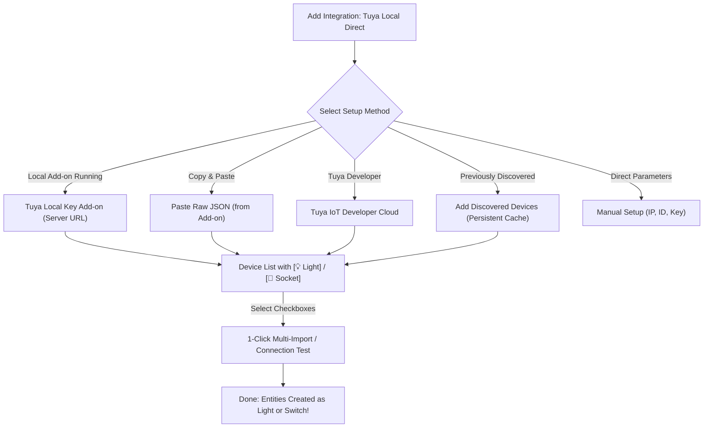

<p align="center">
  
</p>

<p align="center">
  <a href="#-tuya-local-direct-for-home-assistant-english"><strong>🇬🇧 English</strong></a> &nbsp;|&nbsp; 
  <a href="#-tuya-local-direct-für-home-assistant-deutsch"><strong>🇩🇪 Deutsch</strong></a>
</p>

<p align="center">
  <a href="https://github.com/kahel-soft/tuya-lamp-local/releases"></a>
  <a href="https://hacs.xyz"></a>
  <a href="https://www.home-assistant.io"></a>
  <a href="https://github.com/kahel-soft/tuya-lamp-local/blob/main/LICENSE"></a>
</p>

---

# 🇬🇧 Tuya Local Direct for Home Assistant (English)

<p align="center">
  <strong>100% local, latency-free control for Tuya Wi-Fi lights, multi-channel floor lamps (main light + base), and smart sockets/power strips.</strong><br>
  <em>Zero cloud dependency, no bridge required, zero latency – optimized for Home Assistant Green & Home Assistant OS (HOAS).</em>
</p>

## 🌟 Key Features

* **100% Local LAN Control:** Direct communication via TCP port 6668 in your local Wi-Fi. Operates completely independently from the Tuya Cloud — works even during full internet outages.
* **Multi-Fixture Floor Lamps & Dual-Channel Lights:**
  * Automatic detection and independent control for multi-light fixtures (e.g. floor lamps with **Main Uplight** and **Base/Sockel Ambient Light**, or ceiling lights with RGB backlight).
  * Main light and Base/Auxiliary light are created as **separate Home Assistant entities** (`Main Light` and `Base Light`).
  * Full support for dedicated **White Mode** (`ColorMode.WHITE`) and Color Mode (`ColorMode.HS` / `ColorMode.RGB`) without data point collisions.
* **Smart Sockets & Multi-Outlet Power Strips (`switch`):**
  * Plugs and power strips (categories `cz`, `pc`) are automatically recognized and registered as **`switch` with device class `outlet`** — not misidentified as lights!
  * **Multi-Outlet Strips (`pc`):** Each outlet (`Socket 1`, `Socket 2`, `USB`) is registered as a separate switch entity under a unified device.
  * **Relay Protection for Energy Monitoring:** Prevents relay malfunction on power-metering sockets (voltage measurement on DP 20 is ignored; the relay operates safely via DP 1).
* **Dynamic Entity Registration & Live Rescan:**
  * When new light channels or socket outlets are detected at runtime, they are **automatically registered without requiring a Home Assistant restart**.
  * Via **Configure $\rightarrow$ Rescan Device Type, Outlets & Live DPs**, any device can be live-probed and re-synchronized directly over Wi-Fi with one click.
* **Persistent Local Device Cache & Multi-Select Setup:**
  * Discovered devices from the *Tuya Local Key* add-on or cloud query are persistently stored in Home Assistant storage (`.storage`).
  * On subsequent setups, the **`Add Discovered Devices (Cache)`** option appears at the very top — no need to re-query servers or re-paste JSON.
  * Multi-select support: Add multiple or all discovered lights and sockets simultaneously via checkboxes with 1 click.
  * Clear visual type tagging in the setup list: **`[💡 Light]`** or **`[🔌 Socket]`**.
* **Single-Socket Concurrency Lock:**
  * Prevents Tuya Wi-Fi microcontrollers from locking up via thread-safe socket synchronization and executor offloading.
* **Broad Protocol Support:**
  * Tuya protocols **3.1, 3.3, 3.4, and 3.5** (including modern AES-GCM and session key handshakes).
* **Native Home Assistant OS Optimization:**
  * No external bridges, no Docker sidecars, no Node-RED, no MQTT required. Runs natively inside Home Assistant Core.

---

## 📦 Installation via HACS

Install as a **custom repository** in HACS:

1. Open **HACS** in Home Assistant.
2. Click the three dots in the top-right corner $\rightarrow$ **Custom repositories**.
3. Enter:
   * **Repository:** `https://github.com/kahel-soft/tuya-lamp-local`
   * **Category:** `Integration`
4. Click **Add**.
5. Search for **Tuya Local Direct**, click on it, and select **Download**.
6. Restart Home Assistant (**Developer Tools $\rightarrow$ Restart**).

---

## ⚙️ Device Setup (Web UI)

Navigate in Home Assistant to **Settings $\rightarrow$ Devices & Services $\rightarrow$ Add Integration** and search for **Tuya Local Direct**.



### Discovery Methods:
1. **Discovered Devices Cache (Fastest):** If you previously queried devices, unconfigured devices are cached locally. Select them via checkboxes and add them in bulk.
2. **Tuya Local Key Add-on (Server URL):** Automatically fetches all devices from the running add-on (`http://localhost:8000`).
3. **Paste Raw JSON:** Copy the Raw JSON export from your Tuya Local Key add-on and paste it directly. Local IPs are auto-resolved if not specified.
4. **Tuya IoT Developer Cloud:** Direct query using your iot.tuya.com developer credentials (Access ID, Access Secret, Region, Device ID).
5. **Manual Setup:** Directly enter IP address, Device ID, and 16-character Local Key.

---

## 🎛️ Options Flow & Device Customization

Click **Configure** on any device card in Home Assistant:

1. **Rescan Device Type, Outlets & Live DPs:** Live query that re-probes all active data points, detects newly available channels (e.g. base light), and updates entity states.
2. **Network & Connection Settings:** Update IP address (after DHCP changes), update Local Key, choose protocol version (`auto`, `3.3`, `3.4`, `3.5`, `3.1`), or change polling interval.
3. **Data Points & Value Ranges:** Fine-tune brightness ranges (e.g. 10–1000), color temperature limits (Kelvin ranges), color encoding, or secondary/auxiliary light DPs (power DP 102, brightness DP 103, color DP 105, mode DP 106).

---

## 🔌 Supported Device Types

| Device Type | Detection Criteria | HA Platform | Features |
| :--- | :---: | :---: | :--- |
| **Smart Plug / Single Socket** | `cz`, standard socket DPs | `switch` (`outlet`) | Power switching, voltage protection, socket icon |
| **Power Strip (Multi-Outlet)** | `pc`, multiple switch DPs (1..7) | `switch` (`outlet`) | Individual switches (`Socket 1`, `Socket 2`, `USB`) |
| **Smart Wall Switch / Relay** | `kg`, `wk`, `dlq` | `switch` (`switch`) | On/Off relay switching |
| **Standard Dimmable Light** | DP 20/22 or DP 1/3 | `light` | On/Off, Brightness dimming (1–255) |
| **CCT Tunable White Light** | DP 20/22/23 or DP 1/3/4 | `light` | Dimming, Kelvin adjustment (Warm to Cold) |
| **RGB / RGBCW Color Light** | DP 20/22/23/24 or DP 1/3/4/5 | `light` | Dimming, Kelvin, Hue/Saturation, RGB color wheel |
| **Multi-Light Floor Lamp** | DP 101 / 102 / 103 / 105 | `light` (2 entities) | Independent control of **Main Light** and **Base/Sockel** |

---
---

# 🇩🇪 Tuya Local Direct für Home Assistant (Deutsch)

<p align="center">
  <strong>100 % lokale, latenzfreie Steuerung von Tuya Wi-Fi Lampen, Multi-Lichtquellen (z. B. Stehlampen mit Sockel) und smarten Steckdosen.</strong><br>
  <em>Keine Cloud-Abhängigkeit, kein Bridge-Zwang, keine Latenz – optimiert für Home Assistant Green & Home Assistant OS (HOAS).</em>
</p>

## 🌟 Highlights & Funktionen

* **100 % Lokale Steuerung:** Direkte Kommunikation über TCP Port 6668 im lokalen WLAN. Funktioniert dauerhaft autark – auch bei komplettem Internetausfall.
* **Multi-Lichtquellen Unterstützung (Dual-Channel):**
  * Automatische Erkennung und unabhängige Steuerung komplexer Lampen mit getrennten Lichtquellen (z. B. Stehlampen mit **Hauptlicht** und **Sockel/Base-Beleuchtung** oder Deckenleuchten mit indirektem Backlight).
  * Beide Lichtquellen werden als eigenständige Entitäten (`Hauptlicht` und `Sockel`) angelegt und lassen sich unabhängig schalten, dimmen oder einfärben.
  * Vollwertige Unterstützung für **Weißmodus** (`ColorMode.WHITE`) und Farbmodus (`ColorMode.HS` / `ColorMode.RGB`) ohne Datenpunkt-Kollisionen.
* **Smarte Steckdosen & Mehrfachleisten (`switch`):**
  * Sockets und Zwischenstecker (Kategorie `cz`, `pc`) werden automatisch erkannt und als **`switch` mit Geräteklasse `outlet`** angelegt – **nicht fälschlicherweise als Lampe!**
  * **Mehrfachsteckdosen (`pc`):** Jede Steckdose (`Steckdose 1`, `Steckdose 2`, `USB`) wird als separater Schalter unter einem gemeinsamen Gerät bereitgestellt.
  * **Relais-Schutz bei Strommessung:** Verhindert Fehlsteuerungen bei Steckdosen mit Energy Monitoring (Spannungswert auf DP 20 wird ignoriert, Relais sauber über DP 1 geschaltet).
* **Dynamische Erkennung & Live-Rescan:**
  * Erkennt das Plugin beim Polling oder nach dem Einschalten neue Lichtkanäle oder Schalter, werden diese **zur Laufzeit ohne Home Assistant Neustart automatisch nachgetragen**.
  * Über **Konfigurieren $\rightarrow$ Gerätetyp, Steckdosen & Live-DPs neu scannen** kann jedes Gerät jederzeit per Mausklick live im Netzwerk abgefragt und synchronisiert werden.
* **Gerätelisten-Cache & Mehrfachauswahl (Multi-Select):**
  * Einmal gefundene Geräte werden dauerhaft lokal im Home Assistant Speicher (`.storage`) gemerkt.
  * Beim nächsten Klick steht die Option **`Gefundene Geräte hinzufügen`** sofort ganz oben – ohne erneute Serverabfrage oder erneutes JSON-Kopieren!
  * Mehrfachauswahl per Checkboxen: Mehrere oder alle Lampen/Steckdosen können mit einem einzigen Klick gleichzeitig hinzugefügt werden.
  * Übersichtliche Typ-Vorschau in der Liste: direkt mit **`[💡 Lampe]`** oder **`[🔌 Steckdose]`** gekennzeichnet.
* **Single-Socket Lock & Schutz:**
  * Verhindert das Einfrieren der Tuya-WLAN-Chips durch thread-sichere Socket-Verwaltung und synchrone Entkopplung im Home Assistant Executor.
* **Breite Protokoll-Unterstützung:**
  * Unterstützt die Tuya-Protokollversionen **3.1, 3.3, 3.4 und 3.5** (inkl. modernem AES-GCM und Session-Key Handshake).
* **Optimiert für Home Assistant Green (HOAS):**
  * Keine externe Bridge, kein Docker-Sidecar, kein Node-RED oder MQTT nötig. Läuft direkt nativ im Core-Container.

---

## 📦 Installation über HACS

Die Integration kann als **benutzerdefiniertes Repository** in HACS installiert werden:

1. Öffne **HACS** in Home Assistant.
2. Klicke oben rechts auf das Drei-Punkte-Menü $\rightarrow$ **Benutzerdefinierte Repositories**.
3. Trage folgende Daten ein:
   * **Repository:** `https://github.com/kahel-soft/tuya-lamp-local`
   * **Typ:** `Integration`
4. Klicke auf **Hinzufügen**.
5. Suche nach **Tuya Local Direct**, klicke darauf und wähle **Herunterladen**.
6. Starte Home Assistant neu (**Entwicklerwerkzeuge $\rightarrow$ Neu starten**).

---

## ⚙️ Geräte einbinden (Webinterface)

Navigiere in Home Assistant zu **Einstellungen $\rightarrow$ Geräte & Dienste $\rightarrow$ Integration hinzufügen** und suche nach **Tuya Local Direct**.

Wähle deine bevorzugte Einrichtungsmethode:
* **Gefundene Geräte hinzufügen (Cache):** Schnellauswahl bereits abgefragter Geräte ohne neue Abfrage.
* **Tuya Local Key Add-on (Server-URL):** Direkter Abruf über `http://localhost:8000`.
* **Raw JSON einfügen:** Kopierten JSON-Text aus dem Add-on einfügen (lokale IP wird automatisch ermittelt).
* **Tuya IoT Developer Cloud:** Direkte Abfrage über iot.tuya.com Zugangsdaten.
* **Manuelle Einrichtung:** Direkteingabe von IP, Device ID und Local Key.

---

## 🎛️ Konfiguration & Nachträgliche Anpassung (Options Flow)

Über **Konfigurieren** auf der Gerätekarte stehen folgende Funktionen bereit:
1. **Gerätetyp, Steckdosen & Live-DPs neu scannen:** Führt eine Live-Abfrage im WLAN durch und registriert neu gefundene Kanäle (z. B. Sockel-Licht) sofort.
2. **Netzwerk & Verbindung:** IP-Adresse, Local Key, Protokollversion (`auto`, `3.3`, `3.4`, `3.5`, `3.1`) und Abfrageintervall bearbeiten.
3. **Datenpunkte & Grenzwerte:** Manuelle DP-Zuweisung, Dimm- und Kelvin-Grenzwerte, Farb-Codierung und Sockel-Licht DPs (Power 102, Helligkeit 103, Farbe 105, Modus 106).

---

## 🧪 Vorab-Schnelltest direkt am PC (Optional)

Falls du Zugangsdaten und Verbindung vorab direkt vom Computer ohne Home Assistant prüfen möchtest:

```bash
python test_lamp.py
```

Das Skript fragt IP, ID und Key ab, testet automatisch die Protokollversionen (3.3 / 3.4 / 3.5), schlüsselt alle Live-DPs auf, meldet gefundene Lichtquellen oder Steckdosen und bietet einen kurzen Schalttest.

---

## 📁 Dateistruktur

```
custom_components/tuya_lamp_local/
├── __init__.py           # Setup & Plattform-Lifecycle (Multi-Platform: light & switch)
├── manifest.json         # Metadaten, PyPI-Abhängigkeit (tinytuya) & Version
├── const.py              # DP-Definitionen, Farbraum-Konverter & Gerätekategorien
├── coordinator.py        # DataUpdateCoordinator (Socket-Lock, Auto-Detection & Dual Channel)
├── light.py              # Light-Plattform (Hauptlicht & Sockellicht mit Weiß-/Farbmodus)
├── switch.py             # Switch-Plattform (Steckdosen, Zwischenstecker & Mehrfachleisten)
├── icons.json            # MDI-Icon-Definitionen
├── config_flow.py        # UI-Konfigurationsassistent (Discovery, Cache, Multi-Select, Options)
├── strings.json          # Basistexte (Englisch)
├── brand/                # Brand Icons (icon.png, logo.png)
└── translations/
    ├── de.json           # Deutsche Übersetzung
    └── en.json           # Englische Übersetzung
```

---

## 📄 Lizenz

Dieses Projekt steht unter der [MIT Lizenz](LICENSE).
