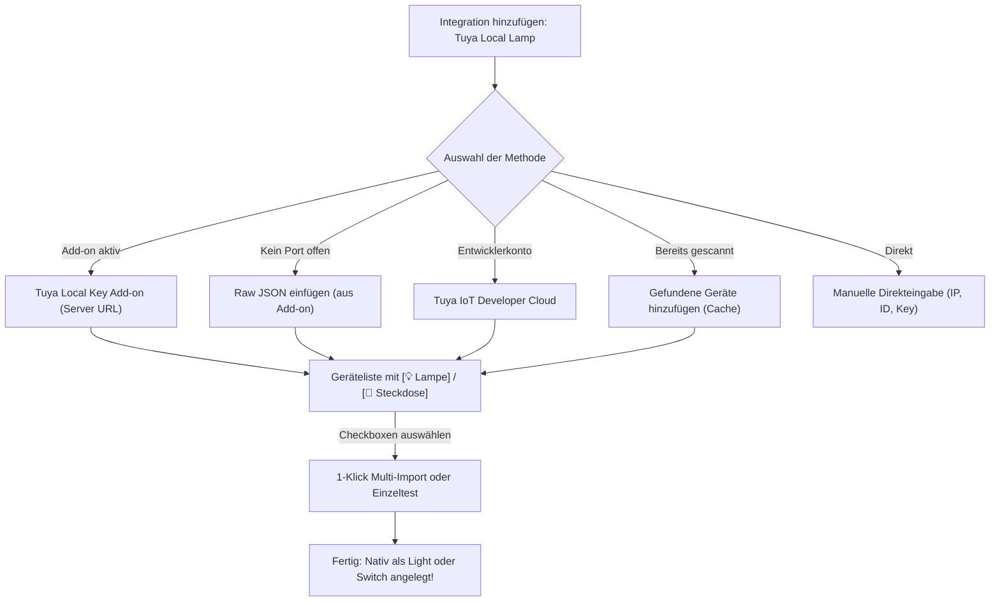

<p align="center">
  
</p>

<h1 align="center">Tuya Local Lamp & Sockets für Home Assistant</h1>

<p align="center">
  <strong>100 % lokale, latenzfreie Steuerung von Tuya Wi-Fi Lampen, Multi-Lichtquellen (z. B. Stehlampen mit Sockel) und smarten Steckdosen.</strong><br>
  <em>Keine Cloud-Abhängigkeit, kein Bridge-Zwang, keine Latenz – optimiert für Home Assistant Green & Home Assistant OS (HOAS).</em>
</p>

<p align="center">
  <a href="https://github.com/kahel-soft/tuya-lamp-local/releases"></a>
  <a href="https://hacs.xyz"></a>
  <a href="https://www.home-assistant.io"></a>
  <a href="https://github.com/kahel-soft/tuya-lamp-local/blob/main/LICENSE"></a>
</p>

---

## 🌟 Highlights & Funktionen

* **100 % Lokale Steuerung:** Direkte Kommunikation über TCP Port 6668 im lokalen WLAN. Funktioniert dauerhaft autark – auch bei komplettem Internetausfall.
* **Smarte Steckdosen & Mehrfachleisten (`switch`):**
  * Sockets und Zwischenstecker (Kategorie `cz`, `pc`) werden automatisch erkannt und als **`switch` mit Geräteklasse `outlet`** angelegt – **nicht fälschlicherweise als Lampe!**
  * **Mehrfachsteckdosen (`pc`):** Jede Steckdose (`Steckdose 1`, `Steckdose 2`, `USB`) wird als separater Schalter unter einem gemeinsamen Gerät bereitgestellt.
  * **Relais-Schutz bei Strommessung:** Verhindert Fehlsteuerungen bei Steckdosen mit Energy Monitoring (Spannungswert auf DP 20 wird ignoriert, Relais sauber über DP 1 geschaltet).
* **Multi-Lichtquellen Unterstützung (Dual-Channel):**
  * Automatische Erkennung komplexer Lampen mit getrennten Lichtquellen (z. B. Stehlampen mit **Hauptlicht** und **Sockel/Base-Beleuchtung** oder Deckenleuchten mit indirektem Backlight).
  * Beide Lichtquellen werden als eigenständige Entitäten (`Hauptlicht` und `Sockel`) angelegt und lassen sich unabhängig schalten, dimmen oder einfärben.
  * Intelligentes Master-Power-Management über DP 20 (`switch_led`).
* **Dynamische Erkennung & Live-Rescan:**
  * Erkennt das Plugin beim Polling oder nach dem Einschalten neue Lichtkanäle oder Schalter, werden diese **zur Laufzeit ohne Home Assistant Neustart automatisch nachgetragen**.
  * Über **Konfigurieren -> Gerät neu erkennen & aktualisieren** kann jedes Gerät jederzeit per Mausklick live im Netzwerk abgefragt und synchronisiert werden.
* **Gerätelisten-Cache & Mehrfachauswahl (Multi-Select):**
  * Einmal gefundene Geräte werden dauerhaft lokal im Home Assistant Speicher (`.storage`) gemerkt.
  * Beim nächsten Klick steht die Option **`Gefundene Geräte hinzufügen`** sofort ganz oben – ohne erneute Serverabfrage oder erneutes JSON-Kopieren!
  * Mehrfachauswahl per Checkboxen: Mehrere oder alle Lampen/Steckdosen können mit einem einzigen Klick gleichzeitig hinzugefügt werden.
  * Übersichtliche Typ-Vorschau in der Liste: direkt mit **`[💡 Lampe]`** oder **`[🔌 Steckdose]`** gekennzeichnet.
* **Single-Socket Lock & Schutz:**
  * Verhindert das Einfrieren der Tuya-WLAN-Chips durch thread-sichere Socket-Verwaltung und synchrone Entkopplung im Home Assistant Executor.
* **Breite Protokoll-Unterstützung:**
  * Unterstützt die Tuya-Protokollversionen **3.1, 3.3, 3.4 und 3.5** (inkl. modernem AES-GCM und Session-Key Handshake).
* **Optimiert für Home Assistant Green (HOAS):**
  * Keine externe Bridge, kein Docker-Sidecar, kein Node-RED oder MQTT nötig. Läuft direkt nativ im Core-Container.

---

## 📦 Installation über HACS

Die Integration kann als **benutzerdefiniertes Repository** in HACS installiert werden:

1. Öffne **HACS** in Home Assistant.
2. Klicke oben rechts auf das Drei-Punkte-Menü $\rightarrow$ **Benutzerdefinierte Repositories**.
3. Trage folgende Daten ein:
   * **Repository:** `https://github.com/kahel-soft/tuya-lamp-local`
   * **Typ:** `Integration`
4. Klicke auf **Hinzufügen**.
5. Suche nach **Tuya Local Lamp**, klicke darauf und wähle **Herunterladen**.
6. Starte Home Assistant neu (**Entwicklerwerkzeuge -> Neu starten**).

---

## ⚙️ Geräte einbinden (Webinterface)

Navigiere in Home Assistant zu **Einstellungen $\rightarrow$ Geräte & Dienste $\rightarrow$ Integration hinzufügen** und suche nach **Tuya Local Lamp**.

Wähle deine bevorzugte Einrichtungsmethode:



### 🌟 Schnellauswahl: Gefundene Geräte hinzufügen (Geräte-Cache)
Sobald du einmal Geräte über Server-URL, Raw JSON oder Cloud importiert hast, merkt sich die Integration alle noch nicht eingerichteten Geräte:
* **Keine erneute Serverabfrage nötig.**
* Wähle einfach per Checkbox die gewünschten Geräte aus und klicke auf **Absenden** – alle Geräte werden sofort parallel eingerichtet!

### 1. Methode: Tuya Local Key Add-on (Server-URL) – Empfohlen!
Wenn das Add-on *Tuya Local Key* auf deinem Home Assistant läuft:
1. Wähle **Tuya Local Key Add-on (Server-URL)**.
2. Die Adresse `http://localhost:8000` ist bereits vorausgefüllt.
3. Klicke auf **Absenden** – die Integration ruft alle Geräte in Sekundenschnelle ab und zeigt dir die Auswahlliste.

### 2. Methode: Raw JSON einfügen
Falls du das Add-on nutzt, aber Port 8000 nicht freigegeben ist:
1. Öffne das Add-on *Tuya Local Key*, wähle deine Geräte und klicke auf **Raw JSON** $\rightarrow$ **Copy**.
2. Wähle **Raw JSON einfügen** und füge den Text in das Eingabefeld ein.
3. *(Optional)* Falls im JSON nur die WAN-IP steht, kannst du deine lokale IP im optionalen Feld eintragen – lässt du es frei, ermittelt die Integration die lokale WLAN-IP in unter einer Sekunde automatisch.

### 3. Methode: Tuya IoT Developer Cloud (iot.tuya.com)
Direkte Abfrage über dein Tuya Entwicklerkonto mittels Region, Access ID (Client ID), Access Secret und einer beliebigen Geräte-ID aus deinem Konto.

### 4. Methode: Manuelle Direkteingabe
Direkteingabe von lokaler IP-Adresse, Device ID und 16-stelligem Local Key für ein einzelnes Gerät.

---

## 🎛️ Konfiguration & Nachträgliche Anpassung (Options Flow)

Über das Zahnrad bzw. **Konfigurieren** auf der Gerätekarte in Home Assistant stehen folgende Optionen bereit:

### 1. Gerät neu erkennen & aktualisieren (Live-Rescan)
* Sendet eine Statusabfrage an das Gerät im lokalen WLAN.
* Aktualisiert die gemeldeten Datenpunkte und erkennt automatisch, ob es sich um eine **Steckdose** oder **Lampe** handelt.
* Findet zusätzliche Lichtquellen (z. B. Sockel/Base-Beleuchtung) und legt diese sofort als neue Entität an.

### 2. Netzwerk & Verbindung
* IP-Adresse aktualisieren (z. B. nach DHCP-Wechsel).
* Local Key erneuern (falls das Gerät in der SmartLife App neu gekoppelt wurde).
* Protokollversion festlegen (`auto`, `3.3`, `3.4`, `3.5`, `3.1`).
* Abfrageintervall (Polling) in Sekunden anpassen.

### 3. Datenpunkte (DPs) & Grenzwerte
* **Gerätetyp:** `auto` (Automatisch erkennen), `light` (als Lampe erzwingen) oder `switch` (als Steckdose/Schalter erzwingen).
* **Live-Werte:** Zeigt alle aktuell von der Lampe/Steckdose gemeldeten DPs live an (z. B. `DP 1: True | DP 20: True | DP 24: 001b01bf03e8`).
* **Helligkeits- & CCT-Grenzwerte:** Einstellbare Minimal- und Maximalwerte für Dimmer (z. B. 10 bis 1000) sowie Farbtemperatur (2700K bis 6500K) inkl. Invertierung (Warm/Kalt umkehren).
* **Farb-DP & Codierung:** 12-stelliges HSV-Hex (`HHHHSSSSVVVV`) oder 6-stelliges RGB-Hex.
* **Multi-Licht DPs:** Zuordnung für Sockel-/Zusatzlicht (Power DP 102, Helligkeit DP 103, Farbe DP 105, Modus DP 106).

---

## 🔌 Unterstützte Gerätetypen

| Gerätetyp | Erkennung | Home Assistant Plattform | Unterstützte Funktionen |
| :--- | :---: | :---: | :--- |
| **Smarte Steckdose / Zwischenstecker** | `cz`, Steckdosen-DPs | `switch` (`outlet`) | Schalten (Ein/Aus), Strommess-Spannungsschutz, Socket-Icon |
| **Mehrfachsteckdosenleiste** | `pc`, Multi-DPs (1..7) | `switch` (`outlet`) | Mehrere Schalter (`Steckdose 1`, `Steckdose 2`, `USB`) |
| **Smarte Wand- & Relaisschalter** | `kg`, `wk`, `dlq` | `switch` (`switch`) | Schalten (Ein/Aus) |
| **Einfache Dimm-Lampe** | DP 20/22 bzw. 1/3 | `light` | Ein/Aus, Dimmen (1–255) |
| **Farbtemperatur-Lampe (CCT)** | DP 20/22/23 bzw. 1/3/4 | `light` | Dimmen, Kelvin-Einstellung (Warmweiß bis Kaltweiß) |
| **RGB / RGBCW Farb-Lampe** | DP 20/22/23/24 bzw. 1/3/4/5 | `light` | Dimmen, Kelvin, Farbkreis (HS / RGB-Farben) |
| **Multi-Licht Stehleuchten (Dual-Channel)** | DP 101 / 102 / 103 / 105 | `light` (2 Entitäten) | Unabhängige Steuerung von **Hauptlicht** und **Sockel/Base** |

---

## 🧪 Vorab-Schnelltest direkt am PC (Optional)

Falls du Zugangsdaten und Verbindung vorab direkt vom Computer ohne Home Assistant prüfen möchtest:

```bash
python test_lamp.py
```

Das Skript fragt IP, ID und Key ab, testet automatisch die Protokollversionen (3.3 / 3.4 / 3.5), schlüsselt alle Live-DPs auf, meldet gefundene Lichtquellen oder Steckdosen und bietet einen kurzen Schalttest.

---

## 📁 Dateistruktur

```
custom_components/tuya_lamp_local/
├── __init__.py           # Setup & Plattform-Lifecycle (Multi-Platform: light & switch)
├── manifest.json         # Metadaten, PyPI-Abhängigkeit (tinytuya) & Version
├── const.py              # DP-Definitionen, Farbraum-Konverter & Gerätekategorien
├── coordinator.py        # DataUpdateCoordinator (Socket-Lock, Auto-Detection & Dual Channel)
├── light.py              # Light-Plattform (Hauptlicht & Sockellicht mit dynamischer Registrierung)
├── switch.py             # Switch-Plattform (Steckdosen, Zwischenstecker & Mehrfachleisten)
├── icons.json            # MDI-Icon-Definitionen
├── config_flow.py        # UI-Konfigurationsassistent (Discovery, Cache, Multi-Select, Options)
├── strings.json          # Basistexte
└── translations/
    ├── de.json           # Deutsche Übersetzung
    └── en.json           # Englische Übersetzung
```

---

## 📄 Lizenz

Dieses Projekt steht unter der [MIT Lizenz](LICENSE).
